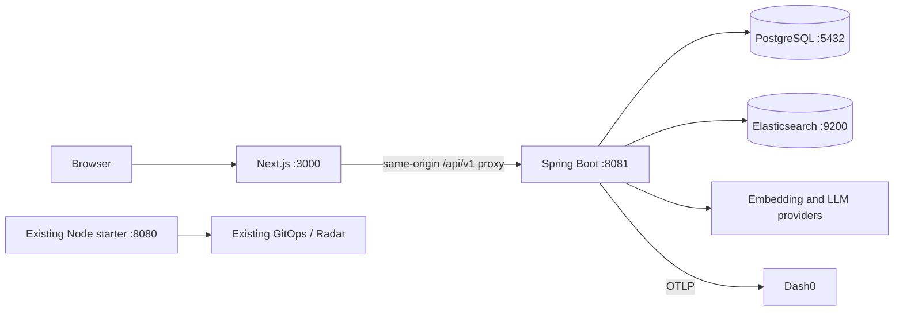

# Conference Wingman architecture

Status: proposed; additive local MVP with existing starter preserved.

## Decision and alternatives

Use a Next.js TypeScript/Tailwind frontend in `web/`, a Java 21 Spring Boot/Gradle backend in `backend/`, and Docker Compose for PostgreSQL and Elasticsearch. PostgreSQL is authoritative; Elasticsearch is a rebuildable projection. Keep the original Node starter and its GitOps route operating independently until a deliberate deployment migration.

Alternatives considered: extend the tiny Node starter (fastest, but fails the requested Java/Next stack); immediately migrate the full application onto Kubernetes (reuses hosting, but adds image routing, resource and Elasticsearch scheduling risk). The additive local stack satisfies the requested technologies while protecting the working starter. Avoid microservices, queues, Kubernetes operators or a second authentication system for the MVP.

## Components and routing

Next serves `/`, `/conferences/new`, `/conferences/{id}/register`, `/organizer` and `/connections`. The browser never addresses Elasticsearch or AI providers. Same-origin proxy forwards cookies, authorization and trace headers without logging their values. Backend port binds to loopback for local execution; API does not allow wildcard credentialed CORS. Proxy must preserve the public cookie path `/api/v1` and handle provider timeouts within its request budget.

Backend packages under `io.conferencewingman`: conference, attendee, registration, matching, ai, security, observability and demo. Use Spring MVC, validation, Data JPA, Flyway, PostgreSQL JDBC, actuator, a single Elasticsearch integration and a minimal HTTP AI adapter. No Spring AI dependency required initially: choose one supported provider protocol per adapter. Add only dependencies needed for acceptance; the existing Node starter has none to reuse.

## Registration and matching flow

1. Validate input and store attendee, registration and matching status `PENDING` in one PostgreSQL transaction. Return success independently of provider availability; issue private attendee cookie.
2. A single bounded scheduled backend worker claims pending registrations from PostgreSQL. MVP runs one backend instance; reset stale `PROCESSING` work after a lease timeout on restart. Maximum three attempts with bounded backoff, then `FAILED`. No external queue.
3. Canonicalize professional profile text, excluding email; call the configured embedding provider and validate dimension, finite values and nonzero norm. Upsert a document keyed by registration ID. Wait for index visibility before searching.
4. Query Elasticsearch kNN with `k=3`, `num_candidates=50`, size 3, and pre-filter on `conferenceId` plus exclusion of own attendee ID. Fetch authoritative candidate registrations from PostgreSQL and reject stale or cross-conference results.
5. Request explanations and openers for all returned candidates in one bounded LLM call. Validate structured response against candidate IDs and length limits. Store result and status `READY`; frontend polls every two seconds for at most 45 seconds, then shows pending/retry rather than polling forever.
6. “Help Me Connect” calls a separate LLM operation for an existing authorized match. It generates text only. All profile text is untrusted data; prompts forbid obeying embedded instructions or inventing facts.

Registration is not rolled back on downstream failure. Intermediate embedding/index status is persisted for safe retries. Reprocessing may recompute matches from the current index; completed results are a snapshot until explicit retry. Retry endpoint returns 202 and queues work rather than blocking HTTP on AI.

## Configuration and dependency gates

Proposed environment contract (values supplied at implementation, never committed): `DATABASE_URL`, `DATABASE_USERNAME`, `DATABASE_PASSWORD`, `ELASTICSEARCH_URL`, `ELASTICSEARCH_API_KEY` when applicable, `EMBEDDING_PROVIDER`, `EMBEDDING_BASE_URL`, `EMBEDDING_API_KEY`, `EMBEDDING_MODEL`, `EMBEDDING_DIMENSIONS`, `LLM_PROVIDER`, `LLM_BASE_URL`, `LLM_API_KEY`, `LLM_MODEL`, `PUBLIC_APP_URL`, `DEMO_SEED_ENABLED`, `APP_VERSION`, `OTEL_SERVICE_NAME`, `OTEL_EXPORTER_OTLP_ENDPOINT`, `OTEL_EXPORTER_OTLP_HEADERS`, `OTEL_EXPORTER_OTLP_PROTOCOL`.

Compose contains pinned PostgreSQL and Elasticsearch versions, named volumes and health checks; development-only unsecured Elasticsearch binds to loopback. Start with Elasticsearch 8.19 API semantics, pin a verified available patch/image digest in M0, and align its client. Verify a supported stable Spring Boot/Gradle pair compatible with Java 21 and a Next.js release compatible with Node 22 before scaffolding; do not use floating `latest`. No versions are asserted installed today.

Prefer a working remote embedding/LLM provider if credentials exist. Ollama is optional only after verifying installed models, hardware, cold-start latency and API adapter. Do not download large models on the critical path. Embedding model/dimension changes require full re-embedding into a new versioned index, never mixing vector spaces. Development stubs may test adapters but must be labeled and cannot pass real-AI acceptance.

## Telemetry and failures

Use one OpenTelemetry instrumentation strategy: Java agent for HTTP/JDBC plus explicitly instrumented application spans, with compatible OTel API/agent versions verified in M0. Export OTLP directly to the Dash0 endpoint using privately supplied headers and protocol. Disable profile/prompt/body capture. Spans: `wingman.registration`, `wingman.embedding`, `wingman.search`, `wingman.llm.matches`, `wingman.llm.introduction`. Record provider/model, duration, outcome, retry count, match count and trace ID; avoid emails, names, tokens and full request URLs with identifiers. Configure exporter batching/timeouts so telemetry outage does not fail registration.

Embedding timeout 10 seconds, search 3 seconds, each LLM call 15 seconds; worker attempt deadline 40 seconds. Provider errors are classified retryable/nonretryable; user sees safe messages and a trace ID, never provider payloads. Readiness checks PostgreSQL; search/AI readiness appears as degraded capability, not failed liveness. Preserve version/health endpoints on the future unified route before replacing starter hosting.

## Security and deployment preservation

Organizer uses 32 random bytes, stored as SHA-256 digest with constant-time comparison; raw token only in creation response, copied privately and held in tab memory. Organizer enters it on `/organizer`, sent in Authorization header. No management-link token in URL, browser history or referrer. Attendee uses an independent opaque capability in HttpOnly SameSite=Lax cookie, Secure outside HTTP localhost; its hash belongs to one registration. Apply same-origin checks to mutations, input/output validation, bounded request sizes and basic registration/AI rate limits. Avoid durable browser storage of capabilities. No attendee email in search index, public DTO, LLM prompt or telemetry.

Existing GHCR workflow builds only root `Dockerfile`/`app/`; pushing new local folders does not magically deploy them, although non-Markdown pushes still trigger the starter build. Do not claim the public URL serves Wingman until an explicit later packaging/routing milestone completes. Preserve Radar and preinstalled cluster components. Cluster rollout is optional, must fit team quotas and use the ship skill, with revision/image/URL verification. Local demo uses stable `PUBLIC_APP_URL=http://localhost:3000`; a phone cannot reach localhost QR, so demonstrate decoded URL on the recording computer. Public hosting/phone access is a separate decision.

## Verified technical reference

Context7 consulted on 2026-11-09: [Elasticsearch kNN search request](https://www.elastic.co/guide/en/elasticsearch/reference/8.19/search-search.html) and [kNN pre-filter behavior](https://www.elastic.co/guide/en/elasticsearch/reference/8.19/query-dsl-knn-query.html). Use an indexed dense vector, dimension-matching query vector and filter inside kNN; do not post-filter global neighbors. Pinning and actual integration tests remain required. Other framework API details are intentionally deferred to M0 documentation verification.
